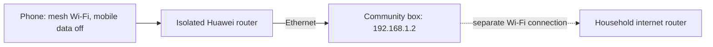

# Test the community box on an isolated mesh Wi-Fi

**Completed and closed6 November at14:03 Nairobi.** Edmund confirmed local page access, sign-in,
the approved answer, existing-note edit/refresh, A1/A2 display separation and a clear no-card
response on the isolated member network. [Results and final checkpoint](../evaluation/trials/2026-11-06-isolated-mesh-readiness.md).
The app links/passwords below describe the archived session; a new session is needed to use it again.

6 November 2026, Africa/Nairobi. This session uses the existing synthetic member node; no model,
GPU rental, router configuration, internet sharing or household internet change is part of it.

## Current physical setup

The computer has Ethernet `192.168.1.2` on the test router (`192.168.1.1`) and Wi-Fi
`192.168.100.192` on the household router (`192.168.100.1`). Edmund identifies the test router as
Huawei HG8145V6 and its wireless network as `mesh`, with no internet uplink. A Wi-Fi name does not
by itself demonstrate multi-hop mesh routing.

The box's own Wi-Fi connection means this is initially a **member network without internet**
test, rather than proof that the entire box lost internet. The node separately disables model
calls and refuses application fetch egress. A later loss/recovery test with enabled compute is
still separate. Do not enable Windows Internet Connection Sharing or bridge the two adapters.

## Archived 6 November session

- Host trial: `95811237-adb9-475b-ab74-477c5b32c7d3`.
- Readiness trial: `e3f71348-6a1a-473e-bfd6-89b93e951bf9`.
- [Temporary test accounts](../../output/member-lan-node/95811237-adb9-475b-ab74-477c5b32c7d3/TEST-ACCOUNTS.md).
- [Community A](http://192.168.1.2:4189/app/?pack=lan-a).
- Planned expiry was **6 November 2026 at15:49 Nairobi**; closed early at14:03. Its in-memory data is gone.
- [Readiness results](../../output/isolated-mesh-session/e3f71348-6a1a-473e-bfd6-89b93e951bf9/summary.json).

These credentials differ from the archived October accounts. Share only the assigned account.
This is plain HTTP with fictional information only. The supplied router screenshot selected
“No Security”; its actual applied configuration has not been checked. A real deployment needs
encrypted Wi-Fi and trusted HTTPS, alongside app authentication.

## Phone procedure

1. Turn mobile data off, join `mesh`, and accept staying connected without internet. Leave the
   computer's separate Wi-Fi connected. Record any VPN or other connection that remains active.
2. In Safari open the Community A link above. In another tab try
   `https://example.com/?afribit-offline-20261106`. Record both results; a cached page is not
   evidence of working internet. Loading a fresh external URL successfully means isolation needs
   investigation before accepting the test.
3. Open My learner account. Sign in as `a1@lan.invalid` using A1's fresh password from the sheet.
   Ask: **When is the fictional ledgerdesk open, and what does a session cost? ledgerdesk**
   Expect Tuesday, 2–4pm, free, with **Approved card: no AI generation**.
4. Add a fictional private note, refresh, and confirm it remains available. Sign out and sign in
   as A2. Confirm only A2's seeded note and no A1 conversation or newly added note.
5. Ask an unrelated question requiring generation. Record the unavailable response; this node
   deliberately has no model provider. Never treat an unavailable response as a GPU failure or
   a measurement of recovery from a disconnected provider.
6. Record observations and the session's shutdown metadata. Keep this run distinct from October's
   successful online-LAN phone observations. Do not mark uplink-loss/reconnection or PWA acceptance
   complete from this test alone.

The assistant can prepare and inspect the host, but someone on the network must operate the
physical phone. At readiness time, no new physical phone result had been received. Edmund subsequently
confirmed **“App loads; internet page fails; Mobile Data off”**. The
[observation record](../../output/isolated-mesh-phone/bbe128e1-3d89-47ea-ba88-774c5c009f5b/observation.json)
establishes user-reported isolated-phone page access. Edmund then confirmed **“Signed in;
Tuesday, 2–4pm, free; approved card shown”** after being asked to keep those conditions unchanged.
The [partial physical checkpoint](../../output/isolated-mesh-phone/74cfe3c6-f977-4adb-bc42-107fe8f58e68/physical-acceptance-checkpoint.json)
records sign-in and the local answer. Edmund then confirmed **“A1 note survives refresh; A2 sees
only its own note/history”**. The [new partial checkpoint](../../output/isolated-mesh-phone/eeca3eed-8274-4cb2-af13-4a4fab228788/physical-acceptance-checkpoint.json)
adds note refresh and same-community display separation. Edmund later clarified that he edited
the existing note, consistent with four remaining seeded-note rows. He also confirmed the
no-matching-card response. [Final closed-session checkpoint](../../output/isolated-mesh-phone/1d619a24-4f5f-4df4-8254-baa524280885/physical-acceptance-checkpoint.json)
retains all results. This did not test note survival after server shutdown; the computer's internet
connection remained separate.

## How the existing Mesh project fits

`D:\dev\wifi\mikrotik` contains MikroTik RouterOS `.rsc` configuration plus HotSpot HTML and
assets. **Do not import those scripts into the Huawei.** They configure RouterOS interfaces,
firewalls, address ranges and HotSpot services, including assumptions about `10.20.0.0/24` and
`10.30.0.0/24`, unlike this `192.168.1.0/24` lab.

`hotspot-mesh/explore.html` provides a service-directory pattern and `site-config.js` has
`localDirectoryUrl` and `communityBoardUrl`. Its app link currently describes a community board;
it has no configured AI service entry. We can add a clearly labeled AI entry when commissioning
that portal. Serving a standalone directory on the community box is also possible; it does not
install a captive portal on the Huawei.

Several links in `mesh.html` point to external learning websites, Signal/Blink or payment flows.
Those need upstream internet and their own services. Copying the page will not make those
services offline. For the offline showcase, list only verified local services and host all needed
assets locally. No files in the separate Wi-Fi project were changed in this pass.

## Names, HTTPS and installation

| Option | What must exist | Suitable use |
|---|---|---|
| `ai.local` | mDNS responder, name-conflict handling, multicast reachability | Convenient same-link discovery; not configured in this session |
| `ai.home.arpa` | Local DNS record and clients using that resolver | Residential-lab name; HTTPS still requires a trusted certificate arrangement |
| A subdomain of a domain Afribit controls | Local DNS, stable/reserved box address, HTTPS reverse proxy and trusted certificate | Recommended product approach; exact community names and domain control still to be chosen/verified |

`.local` is reserved for [multicast DNS, RFC 6762](https://www.rfc-editor.org/info/rfc6762/).
It is not simply an arbitrary suffix to place in a router's conventional DNS table. Multicast
normally stays on its link; routed community segments need deliberate discovery support.
[RFC 8375](https://www.rfc-editor.org/info/rfc8375/) defines `home.arpa` for residential local DNS.
Neither name provides authorization or encryption.

For the product, use a stable HTTPS origin that resolves to the local box inside the community.
Local DNS must continue working without WAN. Certificate issuance/renewal can use
[DNS-01](https://letsencrypt.org/docs/challenge-types/#dns-01-challenge), allowing validation
without exposing the box as a public web server; renewal still needs an operational plan and
internet access for the party performing it. This is a design proposal, not a certificate issued
or domain configured in this trial.

The web project already contains a manifest and service worker, but this bounded HTTP test node
does not serve `/sw.js` and does not prove installation. Phones need a secure context for
[service workers](https://developer.mozilla.org/en-US/docs/Web/API/Service_Worker_API/Using_Service_Workers).
An HTTP private address, or changing it to an HTTP local hostname, does not supply that context.
On a phone, `localhost` refers to the phone. Test installation, first-load caching and offline
relaunch separately once trusted HTTPS is available.

## Navigation and community membership

An app can show a helpful home link for its own unknown page paths. API failures and unavailable
compute must retain their real status and message. A service worker can handle its own origin
and scope; it cannot catch another website's 404, DNS failure, or HTTPS connection and route it
to Afribit. Use a QR code, bookmark, PWA home-screen icon, or a deliberately commissioned captive
portal for discovery. HTTPS interception is not a substitute: MikroTik explicitly documents
[certificate mismatch problems](https://help.mikrotik.com/docs/spaces/ROS/pages/56459266/HotSpot%2B-%2BCaptive%2Bportal).

Membership should combine steward-issued invitations/accounts, closed public registration,
revocation, and server-side authorization for every community, conversation, note and compute
request. The SSID, a local name, an IP address, or portal payment alone is not identity. The
existing member routes already enforce account/community access; production identity governance
and transport remain separate deployment work.

Keep the box off public ingress: bind intended LAN interfaces, configure scoped firewall rules,
and verify IPv4/IPv6 reachability and absence of unwanted forwarding/tunnels. If remote access is
offered, make it an explicit authenticated VPN/service with policy. For rented compute, the box
can initiate authenticated outbound requests; members do not need direct provider credentials
or public inbound access to their community box. Local access and remote compute consent/limits
remain separate decisions.

Cache the application shell/assets in the PWA. Keep authenticated API responses and private
account data out of shared shell caches; any deliberate offline personal storage needs its own
account separation, sign-out behavior, retention and device-loss design. A PWA shell alone
cannot answer a fresh request when neither a local service nor suitable on-device model exists.
